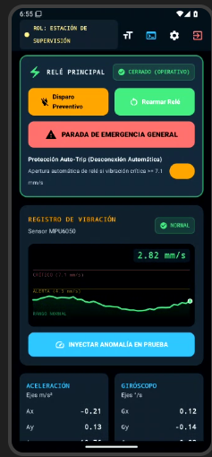
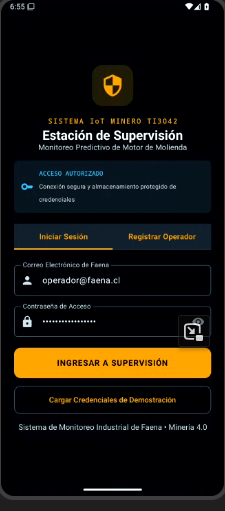
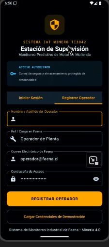
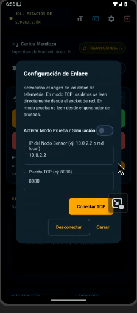
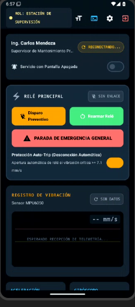
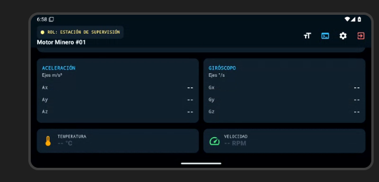

# Estación Minera TI3042 — Supervisión de Motores (IoT)

**Evaluación Sumativa 2 (ES2) — Asignatura TI3042: Aplicaciones Móviles para IoT / Sistemas y Redes Industriales**  
**Proyecto:** Estación Móvil de Supervisión y Control para Motores Mineros (Chancado y Molienda) con Disparo de Relé por Vibración ISO 10816-3.



---

## 1. Descripción del Sistema

La **Estación Minera TI3042** es una estación de supervisión de alta fiabilidad para activos mecánicos críticos en faena minera (molinos SAG, chancadores y motores de pulpa). Monitorea telemetría física procedente de nodos sensores basados en el sensor inercial **MPU6050** y comanda el relé electromecánico de desenergización (GPIO 26) ante eventos de sobrevibración destructiva según la norma internacional **ISO 10816-3**.

---

## 2. Capturas de Pantalla — APK Nativo Ejecutándose

Capturas directas del build nativo Kotlin/Jetpack Compose corriendo en el emulador de Google AI Studio.

| Autenticación Cifrada (ISO 27400) | Registro de Operador | Configuración de Enlace TCP |
|:---:|:---:|:---:|
|  |  |  |

| Estado Sin Enlace (Auto-Trip armado, gráfico vacío limpio) | Modo Horizontal — Motor Minero #01 |
|:---:|:---:|
|  |  |

---

## 3. Características Principales Portadas

1. **Autenticación Cifrada Segura (ISO 27400):**
   - Emulación de almacenamiento criptográfico con AES-256 GCM (`EncryptedAuthStore`).
   - Botón de carga rápida de credenciales de evaluación (`operador@faena.cl` / `MineraSegura2026!`).
   - Gestión de perfiles y roles de supervisión (Supervisor de Mantenimiento, Operador de Faena).

2. **Panel de Mando y Supervisión en Tiempo Real:**
   - **Identificación Inequívoca:** Rol visible permanente en barra superior (`[ ROL: ESTACIÓN DE SUPERVISIÓN ]`).
   - **Placa de Control de Relé:** Indicador de estado del relé (CERRADO / OPERATIVO vs. ABIERTO / DISPARADO), botón de **Parada de Emergencia** con diálogo de confirmación de seguridad y auditoría de operador, y botón de **Rearme de Circuito**.
   - **Disparo Preventivo Automático (Auto-Trip):** Apertura inmediata del relé ante detección sostenida de vibración en Zona D (&gt; 7.1 mm/s).

3. **Monitoreo de Vibración RMS (Norma ISO 10816-3):**
   - **Osciloscopio en Vivo en Canvas:** Trazo de forma de onda, sombreado de gradiente, líneas guía de umbrales a 4.5 mm/s (Zona C: Alerta) y 7.1 mm/s (Zona D: Crítica) con etiquetas milimétricamente alineadas sobre panel HMI oscuro (`ScopePanel`).
   - **Inyector Interactivo de Falla:** Alterna entre operación nominal de faena y modo de anomalía crítica de vibración.
   - **Doble Codificación Accesible:** Todos los estados presentan color + icono + texto.

4. **Telemetría Física Completa del Motor:**
   - Temperatura de devanado en °C con barra de nivel.
   - Tacómetro de velocidad rotacional en RPM (1485 RPM nominal, 0 RPM tras parada).
   - Acelerometría triaxial MPU-6050 ($A_x, A_y, A_z$ en $g$).

5. **Consola de Tramas `>_` y Configuración de Red:**
   - Visualizador de tramas JSON delimitadas por `\n` recibidas (RX), comandos enviados (TX) y eventos de sistema (SYS).
   - Modos de enlace configurables: Simulador Interno MPU6050 a 2 Hz o Socket TCP en vivo (ESP32 / Python `tools/sensor_node_simulator.py` en puerto 8080).
   - Resiliencia ante microcortes con reconexión automática configurable.
   - Selector de vista: **Vista Móvil Android** (con marco de dispositivo móvil, barra de estado y navegación) o **Vista Estación HMI** (pantalla completa).

---

## 4. Estructura del Proyecto

Código fuente consolidado en la raíz — lo mínimo necesario para compilar el APK y el firmware.

```
IOT_E2/
├── app/src/main/java/com/example/
│   ├── ui/              (LoginScreen.kt, MonitoringScreen.kt, components/, theme/)
│   ├── network/         (TcpSocketClient.kt, SensorSimulator.kt — cliente TCP :8080)
│   ├── model/           (TelemetryModels.kt — contratos JSON de telemetría)
│   ├── security/        (EncryptedAuthStore.kt — AES-256 GCM, ISO 27400)
│   └── service/         (MonitoringForegroundService.kt — resiliente a Doze)
├── gradle/, build.gradle.kts, settings.gradle.kts   ← Proyecto Android estándar
├── tools/sensor_node_simulator.py   ← FUENTE DE VERDAD del protocolo (nodo sensor Python)
├── firmware/            ← ESP32 PlatformIO (src/main.cpp monolito)
├── docs/img/            ← Capturas del APK en ejecución
└── docs/README-ANDROID.md ← Diseño y problemática del producto (documento detallado)
```

---

## 5. Ejecución e Instalación

**Compilación del APK** (esta máquina solo edita; el build se hace externo):
- **Google AI Studio** (flujo del proyecto): repo importado como proyecto nativo Kotlin → build → **descargar el APK**.
- **Android Studio** (alternativa en otra máquina): abrir la raíz del repo (`settings.gradle.kts` importa `:app`).

**Instalación vía ADB** (con el teléfono conectado y la depuración USB autorizada):

```bash
adb install -r <ruta>/estacion-minera.apk
```

**Nodo sensor (lado servidor TCP :8080)**: la app es cliente TCP.
- Simulador en PC: `python3 tools/sensor_node_simulator.py`
- Hardware real: cargar `firmware/` con `pio run -t upload` (ESP32 + MPU6050 + relé GPIO 26).

---
